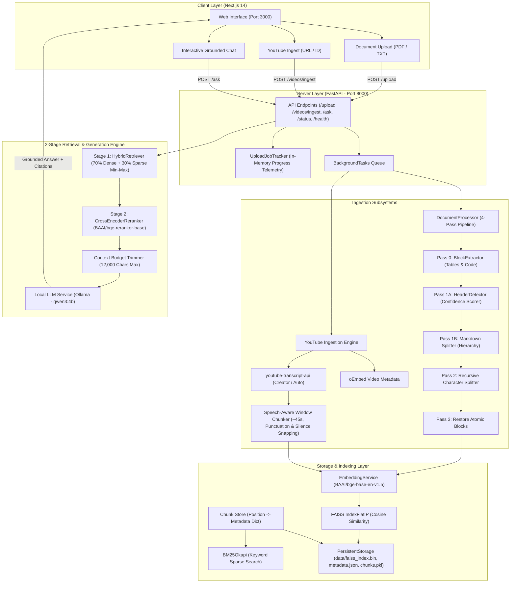

# Project Walkthrough: Local-First Document & YouTube RAG Assistant

> **Final Year Project Architecture & Engineering Guide**  
> *A local-first, privacy-preserving Retrieval-Augmented Generation system for documents and YouTube videos.*

---

## 1. Executive Summary

Traditional Retrieval-Augmented Generation (RAG) applications face critical structural weaknesses:
1. **Fragmented Chunking**: Arbitrary token splitters break tables mid-row, slice code blocks in half, and sever section heading contexts from their corresponding paragraphs.
2. **Shallow Vector-Only Retrieval**: Pure semantic vector matching misses exact terms, part numbers, tabular data, and specific acronyms.
3. **Cloud & Privacy Risks**: Uploading proprietary PDFs or proprietary media transcripts to cloud-hosted APIs leaks data and incurs ongoing per-token costs.
4. **Single-Modality Bottleneck**: Most document assistants ignore video content or fail to provide precise timestamp deep links into video evidence.

This project delivers an end-to-end, **100% local-first** RAG solution that runs entirely on local hardware (via **Ollama**, **FastAPI**, **FAISS**, and **Next.js 14**). It ingests both **documents (PDF, TXT)** and **YouTube video transcripts**, indexes them with a dense-sparse hybrid vector engine, and lets users ask natural language questions with strictly grounded answers, section breadcrumbs, and clickable YouTube timestamp deep links (`t=...s`).

---

## 2. System Architecture



---

## 3. Deep Dive: Ingestion Subsystems

### 3.1 Document Ingestion Pipeline (`src/ingestion/processor.py`)

When a PDF or plain text file is uploaded, it undergoes a **4-pass pipeline** before embedding:

1. **Layout-Aware PDF Extraction**:
   - `pdfplumber` analyzes each page.
   - Bounding boxes for detected tables are extracted first. Characters located *inside* those bounding boxes are filtered out of prose text to prevent tabular data from appearing twice (once garbled in prose and once formatted).
   - Tables are converted into clean GitHub-style Markdown grids (`| col1 | col2 |`).
2. **Pass 0 — Atomic Block Isolation (`src/core/block_extractor.py`)**:
   - Tables (Markdown & HTML) and code blocks (triple-backtick fences, `<pre>`, indented code) are extracted and replaced by lightweight tokens (`[BLOCK_0]`, `[BLOCK_1]`).
   - This shields structured content from being broken apart by downstream sentence or token splitters.
3. **Pass 1A — Confidence-Scored Header Normalization (`src/core/header_detector.py`)**:
   - Identifies structural headings in unstructured documents using heuristic confidence scores:
     - Markdown `#` prefix: `1.00`
     - Numbered sections (e.g., `1.2 Methodology`): `0.95`
     - Underlined headers (`Title\n---`): `0.85`
     - Guarded ALL-CAPS headings (with $\ge 200$ chars following): `0.70`
     - Title-cased isolated lines: `0.60`
   - Headings meeting the threshold ($\ge 0.60$) are normalized into clean Markdown `#` syntax.
4. **Pass 1B — Hierarchy-Aware Semantic Splitting**:
   - LangChain's `MarkdownHeaderTextSplitter` breaks text along `#`, `##`, `###` boundaries.
   - Header breadcrumbs (e.g., `H1: Architecture > H2: Database`) are stored in chunk metadata.
5. **Pass 2 — Size Enforcement**:
   - `RecursiveCharacterTextSplitter` subdivides oversized sections (tuned per `DocType`: Technical Spec = 1,500 chars, Narrative = 2,500 chars, Data-Heavy = 800 chars, Default = 2,000 chars) using clean separator fallback (`\n\n` $\rightarrow$ `\n` $\rightarrow$ `. ` $\rightarrow$ `" "` $\rightarrow$ char).
6. **Pass 3 — Atomic Block Restoration**:
   - Placeholders (`[BLOCK_N]`) are swapped back to their complete original table or code representations wrapped in `[ATOMIC_BLOCK]` tags.

---

### 3.2 YouTube Video Ingestion Pipeline (`src/ingestion/youtube.py`)

1. **Zero-API-Key Video Metadata Retrieval**:
   - Extracts canonical 11-character video IDs from standard URLs, shortlinks (`youtu.be`), embeds, and YouTube Shorts.
   - Queries YouTube's public oEmbed service (`https://www.youtube.com/oembed?url=...`) to retrieve video title and channel name without needing Google Cloud credentials.
2. **Robust Multi-Language Caption Fetching**:
   - Uses `youtube-transcript-api` to inspect available caption tracks.
   - Prioritizes **creator-uploaded** transcripts in preferred English locales (`en`, `en-US`, `en-GB`, `en-CA`).
   - If unavailable, falls back to **auto-generated** captions.
   - Provides granular exceptions for `TranscriptsDisabled`, `NoTranscriptFound`, `VideoUnavailable`, `AgeRestricted`, and `IpBlocked`.
3. **Speech-Aware Transcript Chunking**:
   - Audio transcripts lack document headings or page breaks. The engine groups sequential caption segments into temporal windows (~45s target duration, ~10s overlap, 90s ceiling).
   - Windows dynamically snap to natural speech boundaries:
     - Sentence punctuation endings (`.`, `!`, `?`).
     - Significant speaker pauses (>1.2s silence before the next speech packet).
4. **Timestamp Anchoring & Deep Links**:
   - Every chunk calculates its starting second, ending second, formatted timestamp label (`05:18 - 06:05`), and canonical deep link:
     ```text
     https://www.youtube.com/watch?v=VIDEO_ID&t=318s
     ```

---

## 4. Indexing, Vector Storage & Persistence

### 4.1 Dense Embeddings (`src/embeddings/embedding.py`)
- **Model**: `BAAI/bge-base-en-v1.5` (768 dimensions).
- **Asymmetric Retrieval Prefix**: Document chunks are encoded directly, while search queries automatically receive BGE's required instruction prefix:
  `"Represent this sentence for searching relevant passages: "`.
- **L2 Normalization**: All vectors are normalized to unit length upon encoding (`normalize_embeddings=True`).

### 4.2 FAISS Vector Index (`src/vector_store/faiss_index.py`)
- **Index Type**: `faiss.IndexFlatIP` (Inner Product). Because embeddings are L2-normalized, inner product strictly equals cosine similarity.
- **Position-Mapped Chunk Store**: Vectors in FAISS are indexed by integer position (`0, 1, 2, ...`). The `_chunk_store` dictionary maps each position directly to full metadata:
  ```python
  {
      "doc_id": "yt_ohjXRswUYqM",
      "text": "...",
      "source_type": "youtube",
      "video_id": "ohjXRswUYqM",
      "video_title": "A.R. Rahman: The Genius...",
      "channel": "Nikhil Kamath",
      "start_seconds": 318.0,
      "end_seconds": 365.2,
      "timestamp_url": "https://www.youtube.com/watch?v=ohjXRswUYqM&t=318s",
      "transcript_origin": "creator",
      "headers": {"H1": "A.R. Rahman...", "H2": None, "H3": None},
      "source_label": "A.R. Rahman... [05:18 - 06:05]"
  }
  ```

### 4.3 BM25 Sparse Index (`src/retrieval/hybrid.py`)
- An in-memory `BM25Okapi` index is generated over tokenized chunk texts.
- Synchronized after every upload and rebuilt on server startup from persisted chunks.

### 4.4 Disk Persistence (`src/persistence/storage.py`)
State persists across server reboots inside the `./data/` directory:
- `data/faiss_index.bin`: Native FAISS serialized index binary.
- `data/metadata.json`: High-level document registry (document IDs, filenames, titles, duration, chunk counts).
- `data/chunks.pkl`: Pickled positional dictionary of chunks and metadata.
- **Dimension & Migration Safeguards**: Validates stored index dimensions against `settings.EMBEDDING_DIMENSION` at startup. Automatically migrates legacy data tuples to the modern metadata schema without data loss.

---

## 5. Two-Stage Retrieval & Generation Engine

```
User Query: "What did the speaker say about composition at the beginning?"
                         │
                         ▼
┌─────────────────────────────────────────────────────────────┐
│ STAGE 1: Hybrid Fusion Retrieval                            │
│ - FAISS Dense Search (Cosine Similarity)                    │
│ - BM25 Sparse Search (Exact Keyword Match)                  │
│ - Per-channel Min-Max Normalization to [0, 1]               │
│ - Fusion Score = (0.70 × Semantic) + (0.30 × Keyword)      │
│ Output: Top 15 Candidates                                   │
└────────────────────────┬────────────────────────────────────┘
                         │
                         ▼
┌─────────────────────────────────────────────────────────────┐
│ STAGE 2: Cross-Encoder Reranking                            │
│ - Model: BAAI/bge-reranker-base                             │
│ - Joint full self-attention across (Query, Passage) pairs   │
│ - Sigmoid relevance scoring                                 │
│ Output: Top 8 Shortlisted Candidates                        │
└────────────────────────┬────────────────────────────────────┘
                         │
                         ▼
┌─────────────────────────────────────────────────────────────┐
│ CONTEXT BUDGET ENFORCEMENT                                  │
│ - Ceiling: 12,000 characters (~3,000 tokens)                │
│ - Trims lowest-scoring candidates from the tail if exceeded │
└────────────────────────┬────────────────────────────────────┘
                         │
                         ▼
┌─────────────────────────────────────────────────────────────┐
│ OLLAMA LLM INFERENCE (qwen3:4b)                             │
│ - Instruction-following system prompt with strict grounding │
│ - Content wrapped in <context> ... </context> XML tags      │
│ - think=False to suppress CoT reasoning tokens              │
│ - Regex safety net removes any residual <think> blocks      │
└─────────────────────────────────────────────────────────────┘
```

---

## 6. Asynchronous Background Execution

Large file uploads and long video transcripts cannot block the HTTP request thread. The system uses an asynchronous pipeline:

1. **Fast Dispatch**:
   - `POST /upload` (for files $>1$ MB) and `POST /videos/ingest` write an initial record to the `UploadJobTracker`, schedule a background task, and immediately return HTTP 200 with a `job_id`.
2. **Granular Stage Telemetry**:
   - The job updates through explicit states:
     `queued` $\rightarrow$ `fetching_captions` (15%) $\rightarrow$ `chunking` (30%) $\rightarrow$ `embedding` (40% - 85%) $\rightarrow$ `indexing` (90%) $\rightarrow$ `completed` (100%).
3. **Idempotency Guarantee**:
   - If a user submits a YouTube URL that is already indexed, the system skips re-fetching and indexing, instantly returning the existing document metadata unless `reindex=True` is explicitly passed.

---

## 7. Frontend User Experience (`frontend/`)

Built with **Next.js 14 (App Router)** and **TypeScript**:

- **Dual Ingestion Controls**: Tab toggle between **YouTube Ingest** (URL input field) and **Document Upload** (drag-and-drop zone with PDF/TXT file type validation).
- **Dynamic Polling & Progress Display**: Polls `GET /status/{job_id}` every 800ms during ingestion, displaying an animated progress bar with stage-specific status messages.
- **Interactive Markdown Chat**:
  - Renders LLM output with GitHub Flavored Markdown (`remark-gfm`).
  - Displays a **Relevance Score Badge** (e.g. `92% passage relevance`).
- **Interactive Source Chips**:
  - Collapsible panels displaying passage text and section breadcrumbs.
  - YouTube chips feature a dedicated play pill (`▶ Open at 05:18`) that launches YouTube at that exact second in a new tab.
  - Provenance badges differentiate `creator` captions from `auto` captions.

---

## 8. Repository Structure

```text
YT-RAG(FY_Project)/
├── .env                              # Environment configuration (LLM, embeddings, limits)
├── requirements.txt                  # Python dependencies
├── README.md                         # Project overview
├── PROJECT_WALKTHROUGH.md            # This architectural walkthrough
│
├── data/                             # Persistent storage directory
│   ├── faiss_index.bin               # Persisted FAISS IndexFlatIP binary
│   ├── metadata.json                 # Document registry metadata
│   └── chunks.pkl                    # Chunk store & positional mapping
│
├── src/
│   ├── main.py                       # FastAPI entrypoint, CORS, ML singletons lifecycle
│   ├── api/
│   │   └── routes/
│   │       ├── ask.py                # POST /ask (RAG query pipeline)
│   │       ├── upload.py             # POST /upload (Document ingestion)
│   │       ├── video.py              # POST /videos/ingest (YouTube ingestion)
│   │       ├── status.py             # GET /status/{job_id} (Job polling)
│   │       └── health.py             # GET /health (Health & doc counts)
│   ├── core/
│   │   ├── config.py                 # Pydantic Settings & context presets
│   │   ├── block_extractor.py        # Table & code fence atomic extraction
│   │   └── header_detector.py        # Confidence-based heading detector
│   ├── embeddings/
│   │   └── embedding.py              # BAAI/bge-base-en-v1.5 wrapper
│   ├── generation/
│   │   └── llm.py                    # Ollama client, Qwen3 prompt & think stripper
│   ├── ingestion/
│   │   ├── processor.py              # 4-pass document processor
│   │   └── youtube.py                # YouTube caption fetcher & speech chunker
│   ├── models/
│   │   └── schemas.py                # Pydantic data models & request/response schemas
│   ├── persistence/
│   │   └── storage.py                # State persistence & dimension guard
│   ├── retrieval/
│   │   ├── hybrid.py                 # FAISS + BM25Okapi rank fusion
│   │   └── reranker.py               # BAAI/bge-reranker-base cross-encoder
│   ├── tasks/
│   │   ├── job_tracker.py            # In-memory async job tracker
│   │   ├── uploader.py               # Background document ingestion task
│   │   └── video_ingest.py           # Background YouTube video ingestion task
│   └── utils/
│       ├── errors.py                 # Domain-specific exception hierarchy
│       └── logger.py                 # Console & file logging configuration
│
├── frontend/                         # Next.js 14 App Router application
│   ├── app/
│   │   ├── globals.css               # Styling, badges, source chips, CSS variables
│   │   ├── layout.tsx                # HTML shell
│   │   └── page.tsx                  # Main dual-tab chat & upload UI
│   ├── lib/
│   │   └── api.ts                    # Typed API client functions
│   └── package.json                  # Next.js dependencies
│
└── tests/                            # Automated test suite (24 unit tests)
    ├── test_header_detector.py       # Heading detection heuristic tests
    ├── test_pdf_table_extraction.py  # PDF table exclusion layout tests
    ├── test_scoring.py               # Hybrid scoring & rank fusion tests
    └── test_youtube_ingestion.py     # YouTube parsing, speech chunking & error tests
```

---

## 9. API Reference

### `POST /videos/ingest`
Ingests a YouTube video transcript into the RAG vector store.

**Request Body:**
```json
{
  "url": "https://www.youtube.com/watch?v=dQw4w9WgXcQ",
  "reindex": false
}
```

**Response (HTTP 200):**
```json
{
  "document_id": "yt_dQw4w9WgXcQ",
  "video_id": "dQw4w9WgXcQ",
  "video_title": "Rick Astley - Never Gonna Give You Up (Official Music Video)",
  "channel": "Rick Astley",
  "estimated_duration": 213,
  "status": "processing",
  "stage": "fetching_captions",
  "message": "Video queued for caption extraction and speech chunking.",
  "transcript_origin": "creator",
  "chunks_created": 0,
  "job_id": "6a9e1445-56fa-4573-95fa-b64906bfdcf1"
}
```

---

### `POST /upload`
Uploads and indexes a PDF or TXT document.

**Request:** `multipart/form-data` with key `file`.

**Response (HTTP 200):**
```json
{
  "document_id": "9b1deb4d-3b7d-4bad-9bdd-2b0d7b3dcb6d",
  "filename": "annual_report.pdf",
  "chunks_created": 34,
  "status": "completed",
  "message": "File indexed successfully.",
  "job_id": "9b1deb4d-3b7d-4bad-9bdd-2b0d7b3dcb6d"
}
```

---

### `POST /ask`
Submits a natural-language question against indexed content.

**Request Body:**
```json
{
  "question": "What were the quarterly revenue numbers mentioned?",
  "document_id": "optional-document-or-video-id",
  "top_k": 3,
  "max_context_chars": 12000
}
```

**Response (HTTP 200):**
```json
{
  "answer": "According to the financial breakdown, the revenue in Q1 was $4.2M...",
  "sources": ["passage 1 text...", "passage 2 text..."],
  "source_chunks": [
    {
      "doc_id": "yt_ohjXRswUYqM",
      "text": "...",
      "source_type": "youtube",
      "video_title": "Interview Title",
      "start_seconds": 318.0,
      "end_seconds": 365.2,
      "timestamp_url": "https://www.youtube.com/watch?v=ohjXRswUYqM&t=318s",
      "transcript_origin": "creator",
      "relevance_score": 0.8842,
      "source_label": "Interview Title [05:18 - 06:05]"
    }
  ],
  "relevance_score": 0.8842,
  "context_chars_used": 3420,
  "context_budget_remaining": 8580
}
```

---

### `GET /status/{job_id}`
Polls progress for an asynchronous background upload or video ingest job.

**Response (HTTP 200):**
```json
{
  "job_id": "6a9e1445-56fa-4573-95fa-b64906bfdcf1",
  "status": "processing",
  "stage": "embedding",
  "stage_message": "Generating dense vector embeddings (65%)...",
  "progress": 68,
  "chunks_created": 24,
  "video_title": "Sample Video",
  "channel": "Tech Academy",
  "error": null
}
```

---

## 10. Verification & Quick Start

### Prerequisites
1. **Ollama**: Installed and running locally.
   ```bash
   ollama pull qwen3:4b
   ```
2. **Python 3.10+** and **Node.js 18+**.

### 1. Backend Setup
```bash
# In the repository root
python -m venv venv
venv\Scripts\activate       # On Linux/macOS: source venv/bin/activate
pip install -r requirements.txt

# Start FastAPI server
uvicorn src.main:app --reload
```
* Backend API: `http://localhost:8000`
* Interactive API Documentation: `http://localhost:8000/docs`

### 2. Frontend Setup
```bash
cd frontend
npm install
npm run dev
```
* Web Application: `http://localhost:3000`

### 3. Running Unit Tests
```bash
pytest -v
```
* Runs the test suite across header detection, PDF table isolation, hybrid scoring normalization, and YouTube speech chunking. All 24 unit tests execute deterministically without live network access.

